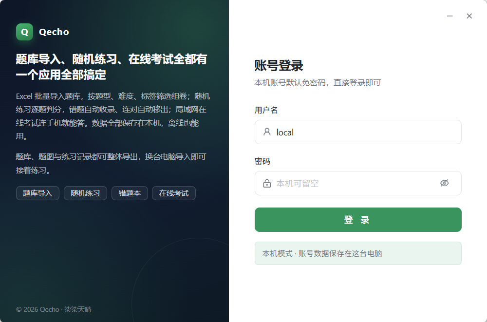

# Qecho

> Qecho（题鸣）—— 题库练习与考试工具，一套代码两种形态：
>
> - **桌面版**：Tauri 2 壳 + Vue 3 前端 + Go 引擎（sidecar）+ SQLite，装在本机即用，数据全部存放在本机，不需要额外服务器。
> - **网页版**：把同一个 Go 引擎部署到服务器，用 `--web-dir` 托管同一份前端，浏览器直接访问，多账号共用一份数据库，适合班级或团队。
>
> 两种形态功能一致；桌面版另有系统托盘、系统保存对话框、防火墙放行等本机集成。

## 界面预览



完整设计见 [docs/题鸣详细设计文档.md](docs/题鸣详细设计文档.md)，安装与操作说明见 [docs/使用手册.md](docs/使用手册.md)，发版与版本清单见 [docs/版本发布.md](docs/版本发布.md)，服务端部署见 [docs/服务端部署.md](docs/服务端部署.md)，Linux 桌面版打包见 [docs/Linux打包.md](docs/Linux打包.md)。

## 当前进度

- 界面：无边框窗口与托盘（桌面版）、深色模式、侧边导航、概览 / 题库 / 练习 / 考试 / 错题本 / 统计 / 设置页面；管理员另有「用户管理」与「数据备份」两个独立页面。
- 本地引擎：`/health` 探活、会话 token（7 天有效；桌面版走本机免密，网页版走账号密码登录）、系统状态、优雅关闭；SQLite WAL 与版本化嵌入迁移。
- 题库管理：题库与题目增删改查，单选/多选/判断、2–8 个选项、答案、解析、难度（1–5 星）、标签、来源，题干与每个选项均可配图；题库列表显示题量、练习正确率、最近练习时间与归属，题目支持按关键词、题型、难度、标签筛选。
- 题库导出：题库详情页一键导出为 Excel（题型/题目/题干图片/选项/答案/解析/难度/标签/来源），桌面端弹系统保存对话框选位置，网页版直接下载；另可把题库引用到的题图打包为 ZIP。导出文件可直接再导入。
- 题库导入：Excel（.xlsx/.xlsm）与 CSV 上传后先预览（工作表/表头行/列映射可改、可导入/重复/错误统计、样例与错误明细），确认后批量入库；导入弹窗可一键下载标准模板（含示例行），重复题可选“跳过”或“保留”，错误行可下载 CSV，整批可撤销（7 天内、未编辑的题目）。导入时可一并选择题图文件，按“题干图片”列的文件名自动关联（大小写不敏感，缺失图片仅提示并显示占位图）。
- 外联考试：按题库抽题生成考试，设置密码、时间窗、时长，并可选打乱题目顺序与选项顺序（每次作答独立洗牌，按选项内容判分）；生成答题链接 `http://<地址>:<端口>/e/<token>`（桌面版是本机 IP，网页版是站点域名），参与者手机/电脑浏览器直接答题，自动保存、断线续答、服务端判分，主机端汇总成绩。
- 桌面集成：Tauri 启动时拉起 sidecar，动态端口通过 `ENGINE_PORT` 回传；sidecar 监听 `0.0.0.0` 以支持外联考试；关闭窗口默认最小化到托盘；分享面板可一键申请防火墙放行。
- 账号与权限：注册（图片验证码）/ 登录 / 退出，首个注册用户自动成为管理员；题库分公共（管理员维护）与个人题库，个人题库可共享给指定用户（只读 / 可编辑）或对所有登录用户开放（只读），访问按「可读 / 可改内容 / 可管理」三级校验，标签的改名、合并与删除仅限题库所有者与管理员。普通用户默认不能新建题库、不能导出导入题库，需管理员在「用户管理」中逐个授予；管理员可查看用户、调整角色、授予权限、重置密码、停用/启用与删除账号。停用会立即踢掉该账号的会话，数据全部保留，可随时恢复；删除必须先停用，删除前自动备份（个人题库一并删除、其外联考试关闭），本机账号与最后一名管理员受保护。共享关系变化（共享给你、权限调整、取消共享、题库被删）会写一条站内通知，顶栏铃铛可查看。设置页可修改自己的密码。
- 练习：题库可多选，按标签、题型、难度筛选（标签可多选，匹配任一），题量 5–500 可调（默认值来自设置），题目与选项可分别乱序；「按题序」时可指定题序范围（从第 N 题到第 M 题，结束留空表示到末题），并显示当前筛选的总题数与本次区间，同题库有历史记录时可直接「接着上次往下练」，避免每次都从第一题重复；支持上一题 / 下一题与标记，逐题判分并实时同步错题本。每次作答、当前题号、标记和单题用时都落库，关闭或刷新后可从未完成记录继续，交卷后按各题用时合计显示练习时长。支持键盘作答：`A`–`H` / `1`–`8` 选择选项，`Enter` 确认或下一题，`←` / `→` 切题；外联答题页同样支持字母/数字选项与方向键导航。
- 错题本：答错自动收录，连续答对达到阈值（默认 2 次，可在设置中调为 1–10）后自动移出；支持待复习 / 已掌握筛选、分页、展开查看选项与解析、单题重练与移出。
- 设置：深色模式、练习默认题量与乱序、错题掌握阈值、自动备份保留份数、智能助手，桌面版另有「关闭窗口时」行为；保存后立即生效并持久化；管理员可打开诊断日志抽屉查看最近日志并一键复制。
- 统计：按近 7 天 / 近 30 天 / 全部汇总答题量、正确率、练习与考试次数、考试平均分，日趋势图、题库正确率排行与标签正确率。
- 标签管理：题库所有者与管理员可在题库详情页重命名、合并或删除标签；合并会把题目转到目标标签，删除只解除关联，均不影响题目本身。标签是跨题库的全局字典，改名会波及他人题库中使用同名标签的题目，因此操作前会提示影响范围（涉及几个题库、多少题，其中几个不属于你）。
- 数据备份：侧边栏「数据备份」页可手动备份、列出与删除；每日首次启动、题库导入前、数据库升级前、恢复前、删除账号前自动备份（每日保留 7 份、导入前 5 份、升级/恢复/删除前各 3 份，份数可在数据备份页调整；自动备份合计超过 2 GB 清理最旧）。备份为含数据库与题图的 zip，恢复前先校验完整性与版本，重启应用后替换生效，失败自动回退到原数据库。
- 题图：题干与选项图片直接上传，按 SHA-256 内容去重存于数据目录 `images/`，单张 ≤ 8 MB（PNG / JPEG / WebP / GIF）；练习、错题本与外联答题页支持缩略图与点击放大，文件缺失时显示占位卡片。题库详情页可把题图整体导出为 ZIP；Excel 导入导出以题干图片文件名表示题图，导入时选择题图文件即可按文件名自动关联，导出 ZIP 可直接作为下次导入的随包图片。
- 智能答疑（可选）：练习作答后在解析区点「问 AI」，右侧答题卡让位给聊天面板（不遮挡窗口按钮），自动把该题发给 AI 分析（题干 + 选项，不含答案与解析）；聊天式布局（提问靠右 / 回答靠左），支持多轮追问、Markdown 渲染、停止生成、思考过程实时展示；**会话常驻**——收起面板不丢记录，输出中的回答后台继续写完，切题再切回来记录也能找回（最近 20 题）。两条通道**二选一生效**、配置独立保存：BIC-QA（数据库智能问答）或任意 OpenAI 兼容大模型（设置页内置阿里云百炼 · 通义千问 / DeepSeek / 智谱 GLM / Kimi / 硅基流动 / 阶跃星辰 / 基元律动 / OpenAI 八家快捷填充），引擎统一代理并把上游流归一化成 SSE 事件（`meta` / `thinking` / `delta` / `error` / `done`），面板标题显示当前生效的服务商；**凭据按账号隔离**，每人一份存于数据目录 `bicqa/user-<id>.json`（0600），不写数据库、不进备份、不回传界面；未配置或关闭时不会发起任何外部请求。默认走「简答」模式（约 200 字，一般 10–20 秒返回），可切「详答」。
- 多语言：界面支持简体中文与 English，登录页右上角与设置页均可即时切换，不刷新页面；切换后组件库（Ant Design Vue）、日期格式（dayjs）与 `<html lang>` 一起跟着变。词条按语言懒加载，不打进首屏包。新增一门语言只需在 `src/i18n/locales/index.ts` 注册表里加一条、再放一个词条文件，页面代码不用改。词条类型由 `zh-CN` 推导（`satisfies MessageSchema`），漏译会在编译期报错。
- 版本更新提示：顶栏铃铛读取公开的发布仓库 `gitee.com/qqtq/qecho-releases` 中的 `version.json`，与当前版本比对，有新版本时显示橙点与橙色卡片（版本号、更新摘要、当前版本与「查看更新」按钮，点击用系统默认浏览器打开下载页）。请求由引擎代拉（成功缓存 30 分钟，点开铃铛强制刷新；拉取失败静默处理，不弹错也不影响使用）。源码仓库已开源，发布仓库只放版本清单与安装包，发版流程见 [docs/版本发布.md](docs/版本发布.md)。
- 网页版部署：同一引擎加 `--host/--port/--web-dir` 即可托管网页版，自带 gzip 压缩、哈希资源长缓存、`ETag`/304 与 `206` 断点续传，首屏传输量未压缩约 1.63 MB，开 gzip 后约 600 KB；支持 systemd 与 Nginx HTTPS，详见 [docs/服务端部署.md](docs/服务端部署.md) 与下文「静态资源托管」。

## 开发运行

```bash
# 终端 1：引擎
cd engine
go run ./cmd/engine --desktop --data-dir ../data --port 54310

# 终端 2：前端（http://127.0.0.1:54311，/api 自动代理到 54310）
pnpm install
pnpm dev
```

`pnpm tauri dev` 的引擎在开发模式下固定用 54310，浏览器与桌面窗口共用同一引擎和数据库；打包后恢复动态端口。

手动启动的引擎要带 `--desktop`，才会对本机回环地址放行免密登录（账号 `local`、密码留空）；不带这个参数时，浏览器打开会被要求输入密码，而本机账号的密码是 PBKDF2 哈希，无法得知。

桌面模式：

```bash
pnpm tauri dev
```

## 打包

```powershell
.\build.ps1          # 桌面端：引擎 sidecar + 前端 + Tauri 安装包
.\build-portable.ps1 # 免安装版：把 release 产物打成 dist-windows\Qecho-<版本>-x64-portable.zip
./build-server.sh    # 服务端：Linux amd64 二进制 → dist-server/
```

`build.ps1` 依次执行 `build-engine.ps1`（Go 引擎 → `src-tauri/binaries/`）、`pnpm install --frozen-lockfile`、`pnpm tauri build`。安装包输出到 `src-tauri/target/release/bundle/nsis/`。

`build-portable.ps1` 不重新编译，只把 `src-tauri/target/release/` 里现成的 `quizbox-desktop.exe`（改名 `Qecho.exe`）、`engine.exe` 和图标收进一个文件夹，附一份使用说明后压成 zip（约 12 MB）。免安装版不写注册表、不建快捷方式，但数据仍在 `%APPDATA%\com.quizbox.desktop`，卸载就是删文件夹加删这个目录。

两个构建脚本都会从 `src-tauri/tauri.conf.json` 读取版本号并注入 `-X main.version`，因此「关于」页与 `/health` 显示的是真实版本；**不要手写不带 `-X main.version` 的 `go build`**，否则会退化成 `dev`，客户端也无法比对版本。

Linux 桌面版（deb / rpm / AppImage）在 Ubuntu 24.04 容器里构建，宿主机只要装了 podman：

```bash
scripts/linux/build-in-container.sh deb    # 也可用 rpm / appimage
```

RHEL 9 系（Rocky、麒麟服务器版）没有 `webkit2gtk-4.1`，无法直接编译 Tauri 2，必须走容器；AppImage 的工具链需要经代理获取。完整说明与已知限制见 [docs/Linux打包.md](docs/Linux打包.md)。

## 静态资源托管（网页版）

`--web-dir` 指向 `dist/`，由引擎自行托管（`engine/internal/api/web.go`，不走 `http.FileServer`）：

| 资源 | 压缩 | 缓存头 | 说明 |
| --- | --- | --- | --- |
| `index.html` 与 SPA 回退 | gzip | `no-cache` + `ETag` → 304 | 保证刷新即拿到新版本 |
| `assets/*`（文件名含内容哈希） | gzip | `public, max-age=31536000, immutable` | 换版本不必清缓存 |
| 图片 / 字体 / ico | 原样 | 同上 | 本身已压缩，不做二次压缩 |

- 客户端带 `Accept-Encoding: gzip` 时现场压缩（`gzip.BestSpeed` + `sync.Pool` 复用 writer），无论文件大小都不额外占内存。
- 非压缩分支交给 `http.ServeContent`，保留 `206` 断点续传、`If-Range`、`If-Modified-Since`；压缩分支是流式编码、无法按字节偏移续传，因此显式返回 `Accept-Ranges: none`，避免浏览器反复重试。
- 路径未命中时：不带扩展名回退 `index.html`（hash 路由），带扩展名直接 `404`，不会把 `nope.js` 当成页面返回。
- 构建侧按 `manualChunks` 把依赖拆成独立 chunk（`vendor-antd`、`vendor-vue`、`vendor-echarts`、`vendor-markdown`、`vendor-icons`，其余归入 `vendor`），首屏 4 个 JS 并行下载；`index.html` 内含 `#boot-splash` 占位（转圈 + 「Qecho 正在加载…」），挂载或启动报错时由 `src/main.ts` 移除。
- 前置 Nginx 时无需再开 gzip（上游响应已带 `Content-Encoding`，Nginx 不会重复压缩）；如需由 Nginx 统一压缩，也可让引擎直出未压缩内容，但要保留 `Cache-Control` 与 `ETag` 透传。

## 数据目录

- 打包运行：`%APPDATA%\com.quizbox.desktop`（由 Tauri 传入引擎）
- 开发运行：项目内 `data/`（通过 `--data-dir` 指定）

## 目录结构

```text
├── src/                 # Vue 3 前端（Vue Router / Pinia / Ant Design Vue）
│   ├── api/             #   axios 封装、引擎与鉴权接口
│   ├── components/      #   PageHeader / MetricTile / WindowControls / AiAnswerDrawer 等
│   ├── layouts/         #   BasicLayout（顶栏 + 侧边菜单）
│   ├── router/          #   hash 路由
│   ├── stores/          #   Pinia（引擎健康、本机会话）
│   └── views/           #   各业务页面
├── src-tauri/           # Tauri 2 壳（sidecar 管理、托盘、窗口）
├── engine/              # Go 引擎（stdlib net/http + modernc.org/sqlite）
│   ├── cmd/engine/
│   └── internal/        #   api / aistream / authx / bicqa / exporter / importer / response / store
├── docs/                # 设计文档
├── release/             # 发版清单模板（version.json / README），内容同步到公开仓库
└── BASELINE.md          # 前端复用基线与依赖差异
```

## 环境

- Node 22+（实测 v22.22.2）+ pnpm 12
- Go 1.23+
- Rust stable-msvc + VS C++ Build Tools（打包桌面端）

## 开源协议

本项目基于 [MIT License](LICENSE) 开源，Copyright (c) 2026 柒柒天晴 (qqtq)。

简单说：你可以自由使用、修改、商用、闭源分发，只需在副本中保留版权声明与许可声明；软件按「现状」提供，不含任何形式的担保。

## 贡献

欢迎提 Issue 反馈问题、提 PR 改进代码。提交前请先读 [CONTRIBUTING.md](CONTRIBUTING.md)，里面有环境要求、提交信息规范和自查命令。

## 致谢

界面基于 Vue 3 与 Ant Design Vue，桌面壳基于 Tauri 2，引擎为 Go 标准库 + `modernc.org/sqlite`（纯 Go 实现，无需 CGO）。
